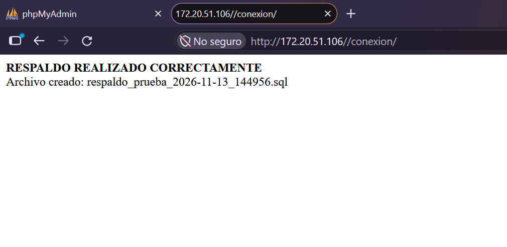

<div style="display: flex; justify-content: space-between; align-items: center;"></div>

<br>
<br>
<br>
<br>

# <center>**TECNOLÓGICO NACIONAL DE MÉXICO**
## <center>**INSTITUTO TECNOLÓGICO DE MILPA ALTA II**

<br>

### <center>INGENIERIA EN SISTEMAS  COMPUTACIONALES
### <center>SEMESTRE: 5

<br>

### <center>ADMINISTRACIÓN DE BASE DE DATOS
### <center>BOLLAS PAREDES DIEGO ALBERTO

<br>

#### <center><u>**RESPALDO DE BASE DE DATOS CON PHP Y PDO**</u>

<br>

#### <center> MARTINEZ VELASCO LIZETH
#### <center>NO.C. 241190035

<br>
<br>
<br>
<br>
<br>
<br>
<br>
<br>

<p style="text-align: right;">13/noviembre/2026</p>

<br>
<br>
<br>

---

### **INTRODUCCIÓN**

<br>

 En esta actividad se comprende la importancia de cuidar la información que guardamos en una base de datos. A veces podemos perder datos por error, borrar algo sin querer o tener algún problema, y es ahí donde los respaldos nos ayudan a no perder todo nuestro trabajo. El objetivo de esta práctica fue crear un programa en PHP con PDO que genere automáticamente un archivo con toda la información de mi base de datos, para poder recuperarla cuando lo necesite.

<br>
<br>
<br>
<br>
<br>
<br>


---

<br>

### **DESARROLLO**

<br>

#### MÉTODO LÓGICO

#### 1. Datos para conectarme a mi base de datos:

<br>

```php
<?php

$hostname = "localhost";
$db_name = "prueba";
$user_name = "liz";
$password = "liz123";
$host = "mysql:host=".$hostname.";dbname=".$db_name.";";

$conexion = null;
```

<br>

#### 2. Intentamos conectarnos a la base

<br>

```php
try{
	$conexion = new PDO ($host,$user_name,$password);
}catch(PDOException $error){
	echo "Error en conexion: ".$error->getMessage();
	exit;
}
```

<br>

#### 3. Función que hace todo el trabajo de respaldo

<br>

```php
function respaldar($conexion){
	// Le ponemos nombre al archivo con la fecha y hora actual
	$archivo = "respaldo_prueba_".date("Y-m-d_His").".sql";
	$contenido = "";

	// Escribimos la fecha dentro del archivo
	$contenido .= "-- Respaldo de base de datos\n";
	$contenido .= "-- Fecha: ".date("Y-m-d H:i:s")."\n\n";

	// Guardamos cómo está creada la tabla
	$contenido .= "-- Tabla: t_prueba\n";
	$contenido .= "DROP TABLE IF EXISTS t_prueba;\n";
	$contenido .= "CREATE TABLE t_prueba (
  		id INT AUTO_INCREMENT PRIMARY KEY,
  		nombre VARCHAR(50) NOT NULL
	);\n\n";

	// Leemos todos los datos que hay en la tabla
	$consulta = "SELECT * FROM t_prueba";
	$resultado = $conexion->query($consulta);
	$registros = $resultado->fetchAll(PDO::FETCH_ASSOC);

	// Guardamos cada dato como una instrucción para volver a insertarlo
	foreach($registros as $fila){
		$contenido .= "INSERT INTO t_prueba (id, nombre) VALUES (".$fila['id'].", '".$fila['nombre']."');\n";
	}

	// Creamos y guardamos el archivo en nuestra carpeta
	file_put_contents($archivo, $contenido);
	echo "<strong>RESPALDO REALIZADO CORRECTAMENTE</strong><br>";
	echo "Archivo creado: ".$archivo."<br>";
}
```

<br>

#### 4. Ejecutamos la función para hacer el respaldo

<br>

```php
respaldar($conexion);

// Cerramos la conexión
$conexion = null;
?>
```

<br>

#### 5. Mensaje de respaldo

<br>




<br>
<br>
<br>


---

<br>

### **CONLUSIÓN**

<br>

Al terminar esta práctica entendí que hacer respaldos no es complicado y que es algo que siempre debemos hacer cuando trabajamos con información importante. Con el código que hice, cada vez que lo ejecuto se genera un archivo  .sql  con toda la estructura y los datos de mi tabla. Si algo le pasa a mi base de datos, puedo usar ese archivo para recuperar todo. Aprendí también la diferencia entre los tipos de respaldo y por qué el respaldo lógico es muy útil y sencillo de usar.